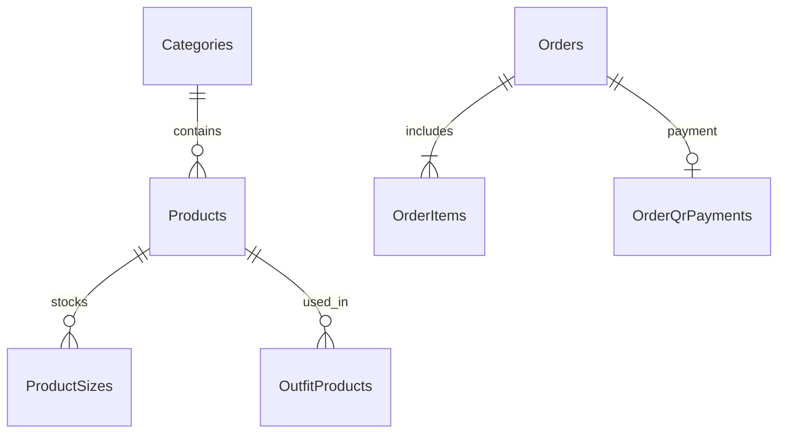

# SQL Server — FashionStoreDB

Server đã kiểm tra trên máy hiện tại: `.\SQLEXPRESS`. Database mới `FashionStoreDB`, Windows Authentication. Không dùng mật khẩu SQL trong mã nguồn. Đăng nhập SSMS: **Server name = .\SQLEXPRESS**, **Authentication = Windows Authentication**; Refresh Databases để thấy database.

## Bảng và quan hệ

| Bảng | Nội dung |
| --- | --- |
| Users | GUID, tên/email duy nhất, hash mật khẩu, quyền/khóa, xác thực OTP |
| Categories | Danh mục |
| Products | Sản phẩm, giá, danh mục, ảnh, trạng thái và ngưỡng kho |
| ProductSizes | Khóa (ProductId, Size), số lượng và thứ tự size; FK Products |
| OutfitProducts | Món phối đồ liên kết Products |
| Orders | Khách/địa chỉ/giá tổng và trạng thái lưu tại thời điểm đặt |
| OrderItems | Khóa (OrderId, LineNumber), FK Orders; tên/giá/size là snapshot lịch sử |
| OrderQrPayments | Một snapshot QR/đơn, trạng thái và audit đối soát, FK Orders |
| QrPaymentSettings | Tài khoản nhận tiền của cửa hàng, một dòng |
| Reviews | Đánh giá và thông tin người gửi |
| StockMovements | Lịch sử kho và liên hệ đơn hàng |
| SchemaVersions | Phiên bản schema |
| LegacySnapshots, ImportHistory | Thời điểm/nguồn nhập và bản chụp lịch sử trước chia size |

Các ID sản phẩm trong OrderItems/Reviews/StockMovements và email khách trong Orders là dữ liệu lịch sử, không ép FK về danh mục/tài khoản hiện tại để giữ đơn/đánh giá cũ sau thay danh mục. Sản phẩm hiện tại có FK Categories; phối đồ có FK Products. Số lượng kho không âm, số lượng đặt >0, tiền dùng decimal(18,2), thông tin tiếng Việt dùng nvarchar. Index duy nhất email, tham chiếu QR và mã giao dịch QR đã xác nhận giúp chặn trùng.

Tổng tồn được tính từ ProductSizes qua view `dbo.InventorySummary`, không duy trì hai số tổng tồn độc lập.



## Tạo và nhập dữ liệu

Dừng tiến trình website JSON trước khi nhập để tránh có đơn mới trong lúc chuyển. Chạy `scripts/Initialize-SqlServer.ps1`; script dùng `dotnet run -- --init-sql`. Quyền tạo database/schema chỉ cần ở bước này. Khởi động bình thường chỉ kiểm tra schema, không tự tạo/nạp lại dữ liệu.

Importer dùng giao dịch SQL: nhập danh mục, sản phẩm/size, phối đồ, tài khoản, đơn/chi tiết/QR, đánh giá, lịch sử kho và cấu hình QR. Giữ GUID/ID, hash mật khẩu, dữ liệu lịch sử. Dữ liệu nguồn không bị sửa/xóa. Với danh mục chưa có tồn theo size, phân bổ tổng cũ như logic hiện có trước khi lưu ProductSizes. Nếu sai ràng buộc hoặc một bước thất bại, rollback toàn bộ dữ liệu nhập. Database đã có dữ liệu bị từ chối nhập đè.

Ảnh/font ở file, bảng size tĩnh ở `wwwroot/data/size-guide.json`; SQL lưu đường dẫn ảnh. Giữ thư mục `.keys` trên máy hiện tại để cookie được đọc đúng. Không nhập SMTP/Cloudflare key vào SQL; dùng biến môi trường như trước.

## Kết nối

`appsettings.json` mặc định:

```json
{
  "Storage": { "Provider": "SqlServer" },
  "ConnectionStrings": {
    "FashionStore": "Server=.\\SQLEXPRESS;Database=FashionStoreDB;Integrated Security=True;Encrypt=True;TrustServerCertificate=True;Connect Timeout=10"
  }
}
```

Có thể đặt `ConnectionStrings__FashionStore` để ghi đè. SQL lỗi sẽ báo lỗi, không âm thầm đọc/ghi JSON. `TrustServerCertificate=True` dành cho SQL cục bộ với chứng chỉ tự ký; khi triển khai server thật dùng chứng chỉ hợp lệ và đặt False.

`dbo.StoreRead` và `dbo.StoreWrite` dùng JSON làm định dạng truyền dữ liệu giữa .NET/SQL, nhưng dữ liệu vận hành lưu ở **cột/bảng quan hệ**, không lưu cả website trong một cột JSON. `OPENJSON`/`FOR JSON` giúp giữ giao diện các module cũ. Các khóa tên collection chỉ nhận danh sách cho phép; tham số dữ liệu dùng SqlParameter. Các thao tác đọc/sửa lồng nhau dùng cùng SqlTransaction và `sp_getapplock` theo transaction để tránh hai kết nối cùng bán đơn vị cuối. Các câu SQL sửa tay không đi qua nghiệp vụ ứng dụng; không sửa tồn/trạng thái trực tiếp khi website đang phục vụ.

Schema hiện yêu cầu SQL Server 2017+ và compatibility level >=140 vì dùng OPENJSON/STRING_AGG. [OPENJSON của Microsoft](https://learn.microsoft.com/en-us/sql/t-sql/functions/openjson-transact-sql?view=sql-server-ver17) và [driver Microsoft.Data.SqlClient](https://learn.microsoft.com/en-us/sql/connect/ado-net/download-microsoft-sqlclient-data-provider?view=sql-server-ver17).

## Kiểm tra bằng SSMS

```sql
USE FashionStoreDB;
SELECT Id, Name, CategoryId, Price FROM dbo.Products;
SELECT * FROM dbo.InventorySummary;
SELECT ProductId, Size, Stock FROM dbo.ProductSizes ORDER BY ProductId, SortOrder;
SELECT Id, CreatedAt, Status, Total FROM dbo.Orders ORDER BY Id DESC;
SELECT OrderId, Status, PaidAt FROM dbo.OrderQrPayments;
```

Không chia sẻ kết quả bảng Users hoặc database chứa dữ liệu cá nhân. Không có tài khoản Admin mới tự tạo khi migrate; tài khoản cũ giữ nguyên quyền và cần OTP email lúc đăng nhập. Nếu chưa có Admin, dùng hướng dẫn seed trong README với email thật.

## Giới hạn và kiểm thử

Các module dùng thao tác danh sách để giữ tương thích đồ án, phù hợp danh mục nhỏ. Nhiều người dùng/máy cần tối ưu truy vấn cập nhật theo dòng/phân trang và thay OTP/session bộ nhớ bằng hệ thống dùng chung. Thử đồ AI, Gmail SMTP và giao dịch ngân hàng thật không được gọi trong kiểm thử tự động.

Lần chuyển trên máy hiện tại đã đối chiếu 31 sản phẩm, 3 tài khoản, 9 đơn/15 dòng đơn và 3 bản ghi kho. Lệnh đối chiếu kỹ thuật: `dotnet run -- --verify-sql-import`; chỉ dùng trước khi SQL có dữ liệu mới khác nguồn JSON.

